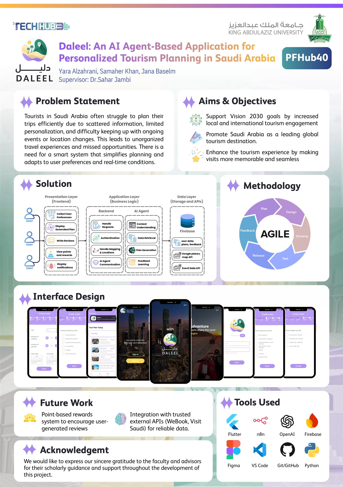

# دليل Daleel — AI Agent-Based Tourism Planner for Saudi Arabia

**Daleel** generates personalized, day-by-day travel itineraries for destinations across Saudi Arabia, powered by an AI agent that reasons over a traveler's dates, budget, and preferences. Built as a graduation project at King Abdulaziz University in support of Saudi Vision 2030's tourism goals.

> This repository is a showcase of the finished project. It's not configured for local setup — Firebase and n8n credentials are intentionally excluded.

---

## The Problem

Tourists visiting Saudi Arabia struggle to plan trips efficiently: information is scattered across sources, generic itineraries ignore personal preferences, and it's hard to keep up with events or changing conditions on the ground. The result is disorganized trips and missed experiences — exactly the friction Vision 2030's tourism push needs solved.

## The Solution

Daleel turns a short preferences form into a complete, personalized itinerary: cities, dates, group composition, activity interests, restaurant styles, and budget tier go in; a structured day-by-day plan with activities, restaurants, costs, and tips comes out — generated by an AI agent rather than a static template.

---

## Tech Stack

| Layer | Technology |
|---|---|
| Mobile App | Flutter (Dart) |
| Authentication | Firebase Auth (email + phone OTP) |
| Database | Cloud Firestore (real-time) |
| Automation / Agent Runtime | n8n Cloud |
| AI Model | OpenAI GPT-4o |
| Maps & Places | Google Maps / Places API |
| Design | Figma |

---

## Features

- 5-step guided trip wizard — destination, travelers, dates, activities, budget
- AI-generated day-by-day itinerary with activities, restaurants, estimated costs, and tips
- Real-time itinerary delivery — no polling, no refresh
- Interactive day map view of each day's route
- Save, revisit, and delete past trips from a personal dashboard
- Activity and place reviews to inform future planning
- In-app notifications

---

## Interface

The poster above includes the core screens end-to-end: onboarding, sign in/up, the trip-creation wizard, and the generated itinerary view. See [`docs/poster.jpg`](docs/poster.jpg) for the full-resolution version.

---

## Team

Built by **Yara Alzahrani**, **Samaher Khan**, and **Jana Baselm**, supervised by **Dr. Sahar Jambi** — King Abdulaziz University.
